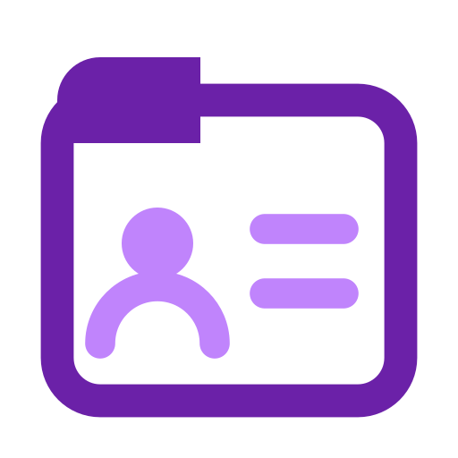

<!-- SPDX-FileCopyrightText: Cadasto B.V. -->
<!-- SPDX-License-Identifier: BUSL-1.1 -->
#  FerroPIX

**Website:** <https://ferropix.eu/> · **Documentation:** <https://ferropix.eu/docs/>

A Master Patient Index for the openEHR platform, in pure Rust: who the patient is.

Every organisation issues its own identifiers for the same person, and records move. FerroPIX holds the cross-reference between those identifiers and the location of each record, and answers the question every other component starts with: who is this patient, and where is their record. It exposes that over the IHE profiles integrators already expect, PIX and PDQ, in their FHIR forms PIXm and PDQm, and it keeps identifying data outside the clinical record, which is where the openEHR Platform Service Model puts the EHR Index.

## What it does

FerroPIX holds the patient identity cross-reference and mints the
pseudonymous identifiers the clinical domain uses, so a clinical record
carries a pseudonym and never a directly identifying identifier. FerroEHR
resolves its `ehr_id` through it, and FerroFED's identity binding points at
it. It serves FHIR and HL7 v2 together:

- **PIXm and PIX:** the identifier cross-reference query (ITI-83 by GET and
  POST, with several target systems) and the FHIR identity feed (ITI-104),
  with the HL7 v2 PIX transactions (ITI-8, ITI-9) beside them.
- **PDQm and PDQ:** the demographics query and match (ITI-78, ITI-119), with
  the HL7 v2 PDQ transactions (ITI-21, ITI-22).
- **PMIR:** the patient master identity feed and subscription (ITI-93,
  ITI-94).
- **The cross-reference:** identifier domains, one source per domain,
  linking and merge, persisted.
- **Pseudonyms:** one per patient and pseudonymisation domain.

It also publishes the libraries of the identity specifications it
implements, for every product to use: `ihe-iti` (the IHE identity profiles,
a feature each) and `nl-generic-functions` (the Dutch Generic Functions).
The book's [crates page](https://ferropix.eu/docs/crates/index.html) lists
every feature with its API reference on docs.rs, and
[getting started](https://ferropix.eu/docs/integrate/getting-started.html)
walks through a first PIXm query.

## Status

The build order is the milestones. v0.0.1 sets up the repository; v0.0.2
moves `ihe-iti` and `nl-generic-functions` here from FerroFED, where they
were built first; v0.0.3 is the server. The specifications are the
authority: the IHE ITI Technical Framework, the IHE PIXm, PDQm and PMIR
implementation guides, HL7 FHIR R4 and HL7 v2. The book's
[status table](https://ferropix.eu/docs/evaluate/what-ferropix-is.html)
says which capabilities are built and which are planned.

## Contributing

See [CONTRIBUTING.md](CONTRIBUTING.md), [SECURITY.md](SECURITY.md) and
[SUPPORT.md](SUPPORT.md). The site is built from `website/`: the landing page
under `website/landing/` and the book under `website/book/`, assembled by
`scripts/site/assemble.sh` and published by the Docs workflow.

## The family

FerroPIX is one of the [FerroHEALTH](https://ferrohealth.eu/) family. The family
page shows where it sits among the eight and what calls what, and this
repository is where the design and the build happen; the tracker is the
record of both. Its site is <https://ferropix.eu/>, and what every product
shares is in the [family book](https://ferrohealth.eu/docs/).

## Licence

FerroPIX is source-available under the Business Source License 1.1. The
parameters that apply, the Licensor, the Licensed Work, the Additional Use
Grant and the Change Date, are in [LICENSE](LICENSE): free for non-commercial
production use, a commercial licence for any other production use, and Apache
2.0 four years after each version is published.

A commercial licence is arranged with [Cadasto B.V.](https://www.cadasto.com),
the Licensor, which handles the business side of FerroPIX: write to
[info@cadasto.com](mailto:info@cadasto.com) or use
[cadasto.com/contact](https://www.cadasto.com/contact/). Technical questions go
to the maintainer named in [MAINTAINERS.md](MAINTAINERS.md).

The brand assets under `assets/brand/` are part of the Licensed Work.

Contributions carry the terms in
[CONTRIBUTING.md](CONTRIBUTING.md#licensing-of-contributions): you keep your
copyright, and you grant the Licensor the relicensing right that keeps the work
one work under one licensor. There is no separate agreement to sign.
