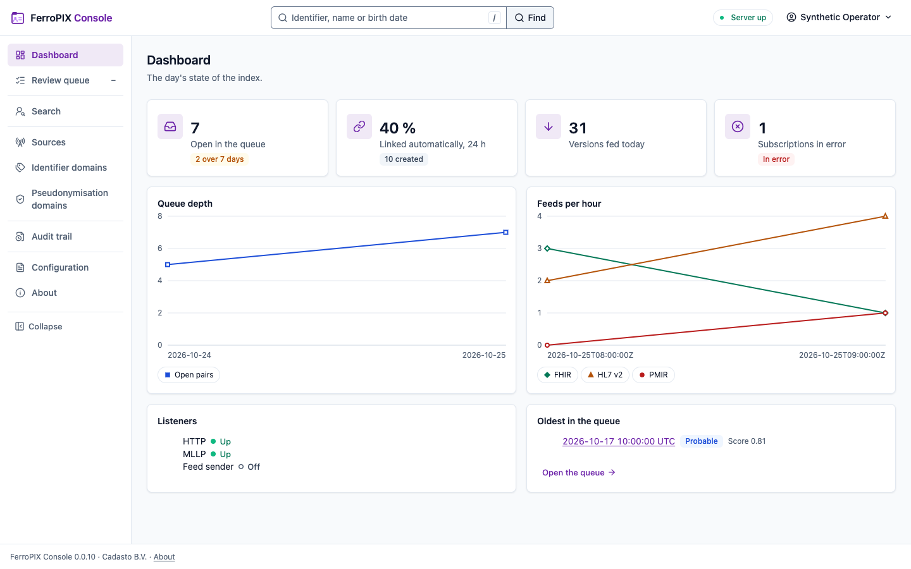

<!-- SPDX-FileCopyrightText: Cadasto B.V. -->
<!-- SPDX-License-Identifier: BUSL-1.1 -->
<div align="center">


**The master patient index: who the patient is, under every identifier, and where their records are.**

<!-- badges:begin -->
**Project**<br>
[](https://github.com/FerroHEALTH/FerroPIX/releases/latest)
[](https://github.com/FerroHEALTH/FerroPIX/actions/workflows/ci.yml)
[](LICENSE)
[](https://ferropix.eu/docs/)
[](https://github.com/FerroHEALTH/FerroPIX/pkgs/container/ferropix)
[](https://github.com/FerroHEALTH/FerroPIX/pkgs/container/ferropix)

**Quality and security**<br>
[](https://scorecard.dev/viewer/?uri=github.com/FerroHEALTH/FerroPIX)
[](https://sonarcloud.io/summary/overall?id=FerroHEALTH_FerroPIX)
[](https://sonarcloud.io/summary/new_code?id=FerroHEALTH_FerroPIX)
[](https://github.com/FerroHEALTH/FerroPIX/actions/workflows/codeql.yml)
[](https://ferropix.eu/docs/operate/deployment.html#verifying-an-image)
[](docs/release.md#the-build-legs)

**Conformance**<br>
[](conformance/pixm/pass-list.txt)
[](conformance/pdqm/pass-list.txt)
[](conformance/pmir/pass-list.txt)
[](conformance/audit/pass-list.txt)
<!-- badges:end -->

[Documentation](https://ferropix.eu/docs/) ·
[Quick start](#quick-start) ·
[What ships today](#what-ships-today) ·
[Licensing](https://ferropix.eu/docs/evaluate/licensing.html)

</div>

## What FerroPIX does

Every hospital, clinic and laboratory gives the same person its own patient
number. When records have to come together, for a referral, a shared care
plan or a regional record, someone has to know that these numbers belong to
one person. Getting that wrong means a record in the wrong file, or a record
that is never found.

FerroPIX keeps that knowledge. It holds the cross-reference between the
identifiers each organisation uses, finds a patient from their name and
date of birth, and flags likely duplicates for a person to review. Other
systems ask it over the IHE profiles hospital integrators already use: PIX
(which identifiers belong together) and PDQ (find a patient by their
details), in their modern FHIR forms PIXm and PDQm and over HL7 v2 messages.

It keeps identifying data in one place, outside the clinical record, which
is where the openEHR platform model puts the patient index.

### Who it is for

- **Hospitals and care networks** that need one reliable view of who a
  patient is across their own systems and their partners'.
- **Integrators and regional exchanges** that link records between
  organisations and need a patient index that speaks the IHE profiles.
- **Data stewards** who review and resolve possible duplicate patients in
  the operator console.

### Why you can trust what it claims

Every release is signed and comes with a software bill of materials (the
list of every component inside) and SLSA build provenance, so you can check
that what you install is what was built here. The source is public, and
every feature is in this repository: there is no paid edition with extra
functions. Each conformance badge above links to its pass list, every
example the IHE PIXm, PDQm and PMIR guides publish, with the reason for any
that fails, so you can check a result against the standard yourself.

## Part of FerroHEALTH

FerroPIX is one of five [FerroHEALTH](https://ferrohealth.eu) servers. Each
does one job and reaches the others only over published standards:
FerroEHR stores the record, FerroBRIDGE translates it to FHIR and the OMOP
research model, FerroFED connects records across organisations and borders,
FerroPIX matches patient identities, and FerroTERM serves the code systems
(the shared lists of medical terms). Any system that speaks PIXm, PDQm or
HL7 v2 can use FerroPIX, not only the FerroHEALTH ones. Sign-in, the audit
trail and the web consoles come from three shared libraries: FerroAUTH,
FerroAUDIT and FerroUI.

<picture>
  <source media="(prefers-color-scheme: dark)" srcset="website/book/src/operate/img/console/dashboard-dark.png">
  
</picture>

## Quick start

The quickstart runs the published image beside PostgreSQL and a development
sign-in server. You need Docker Compose, `git`, `openssl` and `jq`:

```sh
git clone https://github.com/FerroHEALTH/FerroPIX && cd FerroPIX
mkdir -p secrets && umask 077
openssl rand -base64 32 > secrets/ferropix-data-key
openssl rand -hex 16 > secrets/postgres-password
openssl rand -hex 16 > secrets/ferropix-db-password
printf 'postgresql://ferropix:%s@postgres:5432/ferropix' \
  "$(cat secrets/ferropix-db-password)" > secrets/ferropix-db-url
docker compose up --wait
curl http://localhost:8080/health/readiness
```

Then ask for a patient's other identifiers (ITI-83) with a development
token. The store starts empty, so the answer says the identifier is not
known yet:

```sh
token="$(curl -s -d grant_type=client_credentials \
  -d client_id=quickstart-source -d client_secret=any \
  -d scope=system/Patient.rs http://localhost:8180/ferropix/token | jq -r .access_token)"
curl -H "Authorization: Bearer $token" \
  'http://localhost:8080/fhir/Patient/$ihe-pix?sourceIdentifier=urn:oid:2.999.1.1|1'
```

[The PIXm Manager](https://ferropix.eu/docs/integrate/pixm-manager.html)
shows how to feed a patient first, and
[Deployment](https://ferropix.eu/docs/operate/deployment.html) covers the
image, the Helm chart and production settings.

## What ships today

### Patient identity

- [The PIXm Manager](https://ferropix.eu/docs/integrate/pixm-manager.html): the identifier cross-reference query (ITI-83) and the FHIR identity feed (ITI-104)
- [The PDQm Supplier](https://ferropix.eu/docs/integrate/pdqm-supplier.html): find a patient by their details (ITI-78) and match (ITI-119)
- [The HL7 v2 face](https://ferropix.eu/docs/integrate/hl7v2-face.html): the PIX feed and query and the PDQ query over MLLP (ITI-8, ITI-9, ITI-21)
- [Matching](https://ferropix.eu/docs/operate/matching.html): a probabilistic score for every possible duplicate, with a review queue

### Security and audit

- [Who may call the server](https://ferropix.eu/docs/operate/security-and-audit.html#who-may-call-the-server): SMART access tokens from the issuers you trust
- [The audit trail](https://ferropix.eu/docs/operate/security-and-audit.html#the-servers-audit-trail) of every IHE transaction, in the IHE BALP format

### Operations

- [The operator console](https://ferropix.eu/docs/operate/console.html): search, the patient record, the review queue, merge and unmerge
- [The operator API](https://ferropix.eu/docs/operate/operator-api.html) the console reads
- [Container images and release binaries](https://ferropix.eu/docs/operate/deployment.html) for amd64 and arm64, signed, and a [Helm chart](https://ferropix.eu/docs/operate/deployment.html#the-helm-chart)

### Libraries

- [`ihe-iti`](https://ferropix.eu/docs/crates/ihe-iti.html), the IHE identity profiles, and [`nl-generic-functions`](https://ferropix.eu/docs/crates/nl-generic-functions.html), the Dutch Generic Functions, as Rust crates

<details>
<summary><b>Published crates</b> (2)</summary>

| Crate | What it does | Version | Docs | Downloads |
|---|---|---|---|---|
| [`ihe-iti`](https://crates.io/crates/ihe-iti) | The IHE identity profiles PIXm, PDQm, mCSD, PMIR and XCPD, one feature per profile, with their audit records | [](https://crates.io/crates/ihe-iti) | [](https://docs.rs/ihe-iti) | [](https://crates.io/crates/ihe-iti) |
| [`nl-generic-functions`](https://crates.io/crates/nl-generic-functions) | The Dutch Generic Functions: localization (NVI), consent (Mitz), addressing (LRZa) and authentication (Nuts) | [](https://crates.io/crates/nl-generic-functions) | [](https://docs.rs/nl-generic-functions) | [](https://crates.io/crates/nl-generic-functions) |

</details>

## Learn more

- [Documentation](https://ferropix.eu/docs/) and the [FerroHEALTH book](https://ferrohealth.eu/docs/)
- [What FerroPIX is](https://ferropix.eu/docs/evaluate/what-ferropix-is.html), with what is built and what is planned, and [conformance and specification pins](https://ferropix.eu/docs/evaluate/conformance.html)
- [Changelog](CHANGELOG.md) and [milestones](https://github.com/FerroHEALTH/FerroPIX/milestones)
- [Security policy](SECURITY.md)
- [Contributing](CONTRIBUTING.md), [code of conduct](CODE_OF_CONDUCT.md), [support](SUPPORT.md), [governance](GOVERNANCE.md) and [maintainers](MAINTAINERS.md)

## Licence

Business Source License 1.1 ([LICENSE](LICENSE)), with Apache License 2.0 as
the Change License four years after each version; the
[licensing page](https://ferropix.eu/docs/evaluate/licensing.html) says when
you need a commercial licence from Cadasto B.V.
