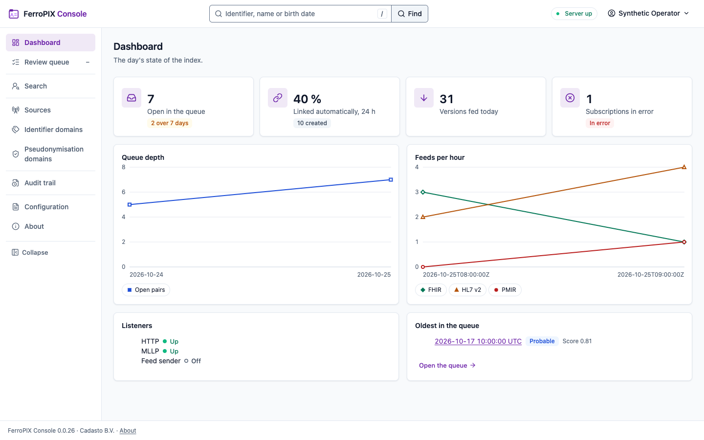

<!-- SPDX-FileCopyrightText: Cadasto B.V. -->
<!-- SPDX-License-Identifier: BUSL-1.1 -->
<div align="center">


**The master patient index: who the patient is, under every identifier, and where their records are.**

[Documentation](https://ferropix.eu/docs/) ·
[Quick start](#quick-start) ·
[What it implements](#what-it-implements) ·
[Licensing](https://ferropix.eu/docs/evaluate/licensing.html)

<!-- badges:begin -->
**Project**<br>
[](https://github.com/FerroHEALTH/FerroPIX/releases/latest)
[](https://github.com/FerroHEALTH/FerroPIX/actions/workflows/ci.yml)
[](LICENSE)
[](https://ferropix.eu/docs/)
[](https://github.com/FerroHEALTH/FerroPIX/pkgs/container/ferropix)
[](https://github.com/FerroHEALTH/FerroPIX/pkgs/container/ferropix)

**Quality and security**<br>
[](https://scorecard.dev/viewer/?uri=github.com/FerroHEALTH/FerroPIX)
[](https://sonarcloud.io/summary/overall?id=FerroHEALTH_FerroPIX)
[](https://sonarcloud.io/summary/new_code?id=FerroHEALTH_FerroPIX)
[](https://github.com/FerroHEALTH/FerroPIX/actions/workflows/codeql.yml)
[](https://ferropix.eu/docs/operate/deployment.html#verifying-an-image)
[](docs/release.md#the-build-legs)

**Conformance**<br>
[](conformance/pixm/pass-list.txt)
[](conformance/pdqm/pass-list.txt)
[](conformance/pmir/pass-list.txt)
[](conformance/audit/pass-list.txt)
<!-- badges:end -->

</div>

## What FerroPIX is

Every hospital, clinic and laboratory gives the same person its own patient
number. When records have to come together, for a referral, a shared care
plan or a regional record, someone has to know that these numbers belong to
one person. Getting that wrong means a record in the wrong file, or a record
that is never found.

FerroPIX is the Master Patient Index of the FerroHEALTH family, in pure
Rust. It holds the cross-reference between the identifiers each
organisation issues in PostgreSQL, finds a patient from their name and date
of birth, sends the pairs its scorer is unsure of to a data steward, and
answers for all of it over the IHE profiles hospital integrators already
use. It also mints the pseudonyms a clinical store names a patient by, so
identifying data stays outside the clinical record, which is where the
openEHR platform model puts the patient index.

It is for hospitals and care networks that need one view of who a patient
is across their own systems and their partners', for integrators and
regional exchanges that link records between organisations, and for the
data stewards who resolve possible duplicates in the operator console.

<picture>
  <source media="(prefers-color-scheme: dark)" srcset="website/book/src/operate/img/console/dashboard-dark.png">
  
</picture>

## What it implements

Each transaction follows the IHE ITI Technical Framework and its
implementation guide, on HL7 FHIR R4, and the book cites the section behind
every answer. A feed over FHIR and a feed over HL7 v2 of the same patient
land in one person, and every query reads the same store.

| Face | Transactions | What it does |
|---|---|---|
| [PIXm Manager](https://ferropix.eu/docs/integrate/pixm-manager.html), PIXm 3.1.0 | ITI-83, ITI-104 | Answers which identifiers the other domains hold for a patient, by `GET` or by a posted `Parameters` body that keeps the identifier out of every URL, and takes each domain's feed, revisions, merges and removals |
| [PDQm Supplier](https://ferropix.eu/docs/integrate/pdqm-supplier.html), PDQm 3.2.0 | ITI-78, ITI-119 | Finds patients by demographics and identifiers, with paging and the domain filter, and `$match` scores a described patient as certain, probable or possible |
| [PMIR Registry](https://ferropix.eu/docs/integrate/pmir-registry.html), PMIR 1.6.0 | ITI-93, ITI-94 | Receives the master identity feed, takes subscriptions, and sends every committed change to each subscriber in order, from an outbox written in the change's own transaction |
| [HL7 v2 PIX and PDQ](https://ferropix.eu/docs/integrate/hl7v2-face.html), ITI TF-2 | ITI-8, ITI-9, ITI-21, ITI-10 | An MLLP listener for the identity feed, the PIX query and the demographics query, and update notifications to the consumers you name, on FerroBRIDGE's v2 parser |
| [XCPD Responding Gateway](https://ferropix.eu/docs/integrate/xcpd-gateway.html) | ITI-55 | Tells another community whether yours knows a patient, by a shared identifier or by demographics, on the same exchange or asynchronously |

Beside the five faces:

- [Matching](https://ferropix.eu/docs/operate/matching.html): an identifier
  in an authoritative domain links two records on its own, a probabilistic
  scorer grades the rest, and the pairs it is unsure of wait in a review
  queue.
- [Pseudonyms](https://ferropix.eu/docs/integrate/pseudonyms.html): one
  pseudonym per patient and pseudonymisation domain, read only by that
  domain's consumer.
- [The Dutch identifiers](https://ferropix.eu/docs/integrate/dutch-identifiers.html):
  the BSN checked by the eleven-proof, and every identifier of a sensitive
  domain sealed at rest and found by a keyed hash.
- [The operator console](https://ferropix.eu/docs/operate/console.html):
  search, the patient record, the review queue, link, merge and unmerge
  with a reason, and every reveal of an identifier recorded as a disclosure.

## Quick start

The quickstart runs the published images beside PostgreSQL 18 and a
development sign-in server, feeds one synthetic patient and asks for it.
You need a checkout, Docker Compose (or Podman with a compose provider),
`curl`, `jq` and `openssl`. Every command below is a step of
[`scripts/quickstart/tour.sh`](scripts/quickstart/tour.sh), which CI runs
against the images each change builds; run the script to do every step at
once. The [Quickstart](https://ferropix.eu/docs/integrate/getting-started.html)
page explains each answer.

```sh
git clone https://github.com/FerroHEALTH/FerroPIX && cd FerroPIX
```

Write the secrets, start the stack and ask for readiness:

<!-- tour:secrets -->
```sh
mkdir -p secrets && umask 077
openssl rand -base64 32 > secrets/ferropix-data-key
openssl rand -hex 16 > secrets/postgres-password
openssl rand -hex 16 > secrets/ferropix-db-password
printf 'postgresql://ferropix:%s@postgres:5432/ferropix' \
  "$(cat secrets/ferropix-db-password)" > secrets/ferropix-db-url
openssl rand -hex 16 > secrets/console-oidc-client-secret
```

<!-- tour:start -->
```sh
docker compose up --wait
curl --fail-with-body -s http://localhost:8080/health/readiness
```

Get a client credentials token that may feed and query:

<!-- tour:token -->
```sh
token="$(curl --fail-with-body -s http://localhost:8180/ferropix/token \
  -d grant_type=client_credentials -d client_id=quickstart-source \
  -d client_secret=any -d 'scope=system/Patient.cud system/Patient.rs' \
  | jq -er .access_token)"
```

Feed a patient as the hospital's Patient Identity Source (ITI-104):

<!-- tour:feed -->
```sh
curl --fail-with-body -s -X PUT \
  'http://localhost:8080/fhir/Patient?identifier=urn:oid:2.999.1.1|H-100001' \
  -H "Authorization: Bearer $token" \
  -H 'Content-Type: application/fhir+json' \
  --data-binary @- <<'EOF' | jq -e '.issue[0].severity == "information"'
{
  "resourceType": "Patient",
  "identifier": [
    { "system": "urn:oid:2.999.1.1", "value": "H-100001" },
    { "system": "http://fhir.nl/fhir/NamingSystem/bsn", "value": "999990007" }
  ],
  "name": [{ "family": "Proefsma", "given": ["Ada"] }],
  "gender": "female",
  "birthDate": "1961-04-12"
}
EOF
```

Ask for the patient's BSN (ITI-83), with the identifier in a posted body:

<!-- tour:identifiers -->
```sh
curl --fail-with-body -s -X POST 'http://localhost:8080/fhir/Patient/$ihe-pix' \
  -H "Authorization: Bearer $token" \
  -H 'Content-Type: application/fhir+json' \
  --data-binary @- <<'EOF' | jq -e '.parameter[] | select(.name == "targetIdentifier") | .valueIdentifier'
{
  "resourceType": "Parameters",
  "parameter": [
    { "name": "sourceIdentifier", "valueString": "urn:oid:2.999.1.1|H-100001" },
    { "name": "targetSystem", "valueString": "http://fhir.nl/fhir/NamingSystem/bsn" }
  ]
}
EOF
```

Find the patient by demographics (ITI-78):

<!-- tour:demographics -->
```sh
curl --fail-with-body -s -X POST 'http://localhost:8080/fhir/Patient/_search' \
  -H "Authorization: Bearer $token" \
  -H 'Accept: application/fhir+json' \
  -d family=proefsma -d birthdate=1961-04-12 \
  | jq -e '.total == 1 and .entry[0].resource.name[0].family == "Proefsma"'
```

Open the operator console on `http://localhost:3000/` and sign in with any
user name:

<!-- tour:console -->
```sh
docker compose --profile console up --wait
```

The development issuer signs a token for any client that asks. It is for
synthetic data on your own machine; `docker compose --profile console down
--volumes` removes everything the tour started.

## Deploy it

Every release publishes, from one tag:

- the server image `ghcr.io/ferrohealth/ferropix` and the console image
  `ghcr.io/ferrohealth/ferropix-console`, for `linux/amd64` and
  `linux/arm64`, on a distroless base;
- the Helm chart `oci://ghcr.io/ferrohealth/charts/ferropix`, which runs
  both under the Restricted Pod Security Standard with the images pinned by
  the digests the release scanned;
- static `ferropix` and `ferropix-console` binaries for `x86_64` and
  `aarch64` Linux on the [GitHub release](https://github.com/FerroHEALTH/FerroPIX/releases).

The server runs beside PostgreSQL 18, the authorization server whose tokens
it reads, an ATNA audit repository and, for the HL7 v2 face, a FHIR R4
terminology server such as FerroTERM.
[Deployment](https://ferropix.eu/docs/operate/deployment.html) covers the
image, the chart and production settings, and
[Configuration](https://ferropix.eu/docs/operate/configuration.html) every
key.

## Security and conformance

- **Who may call it:** SMART access tokens from the issuers you trust, with
  the scope each transaction needs
  ([Security and audit](https://ferropix.eu/docs/operate/security-and-audit.html)).
- **What it records:** an audit record of every IHE transaction in the IHE
  BALP format, sent to your ATNA repository.
- **What you install:** every artifact carries SLSA Build Level 3
  provenance and an SBOM, and every finding of the release's vulnerability
  scan carries an OpenVEX judgement
  ([Verifying an image](https://ferropix.eu/docs/operate/deployment.html#verifying-an-image)).
- **Conformance:** each conformance badge above links to its pass list:
  every example the IHE PIXm, PDQm and PMIR guides publish, with the reason
  for any that fails
  ([Conformance and specification pins](https://ferropix.eu/docs/evaluate/conformance.html)).

The source is public and every feature is in this repository; there is no
paid edition with extra functions.

## Crates

FerroPIX publishes the identity profiles it implements as Rust crates. Each
IHE profile is a feature of `ihe-iti` and each Dutch Generic Function a
feature of `nl-generic-functions`, none on by default:

```sh
cargo add ihe-iti --no-default-features -F pixm
```

| Crate | What it does | Version | Docs | Downloads |
|---|---|---|---|---|
| [`ihe-iti`](https://crates.io/crates/ihe-iti) | The IHE identity profiles PIXm, PDQm, mCSD, PMIR and XCPD, one feature per profile, with their audit records | [](https://crates.io/crates/ihe-iti) | [](https://docs.rs/ihe-iti) | [](https://crates.io/crates/ihe-iti) |
| [`nl-generic-functions`](https://crates.io/crates/nl-generic-functions) | The Dutch Generic Functions: localization (NVI), consent (Mitz), addressing (LRZa) and authentication (Nuts) | [](https://crates.io/crates/nl-generic-functions) | [](https://docs.rs/nl-generic-functions) | [](https://crates.io/crates/nl-generic-functions) |

## Part of FerroHEALTH

FerroPIX is one of five [FerroHEALTH](https://ferrohealth.eu) servers, and
the one that owns patient identity. Each server does one job and reaches
the others only over published standards: FerroEHR stores the record and
finds a patient's EHR through FerroPIX, FerroBRIDGE translates the record
to FHIR and the OMOP research model, FerroFED connects records across
organisations and resolves the patients of a cross-site query here, and
FerroTERM serves the code systems. Any system that speaks PIXm, PDQm, PMIR,
XCPD or HL7 v2 can use FerroPIX.

## Documentation

- [The FerroPIX book](https://ferropix.eu/docs/): evaluate, integrate,
  operate and contribute, and the
  [FerroHEALTH book](https://ferrohealth.eu/docs/) for what the family
  shares
- [What FerroPIX is](https://ferropix.eu/docs/evaluate/what-ferropix-is.html)
  and [Releases, upgrades and support](https://ferropix.eu/docs/operate/releases.html)
- [Changelog](CHANGELOG.md) and [releases](https://github.com/FerroHEALTH/FerroPIX/releases)

## Support and contributing

- [Support](SUPPORT.md) and the [security policy](SECURITY.md)
- [Contributing](CONTRIBUTING.md), [code of conduct](CODE_OF_CONDUCT.md),
  [governance](GOVERNANCE.md) and [maintainers](MAINTAINERS.md)

## Licence

Business Source License 1.1 ([LICENSE](LICENSE)): free outside production
and for non-commercial production use, a commercial licence from Cadasto
B.V. for other production use, and Apache License 2.0 four years after each
version. The [licensing page](https://ferropix.eu/docs/evaluate/licensing.html)
says which applies to you.
