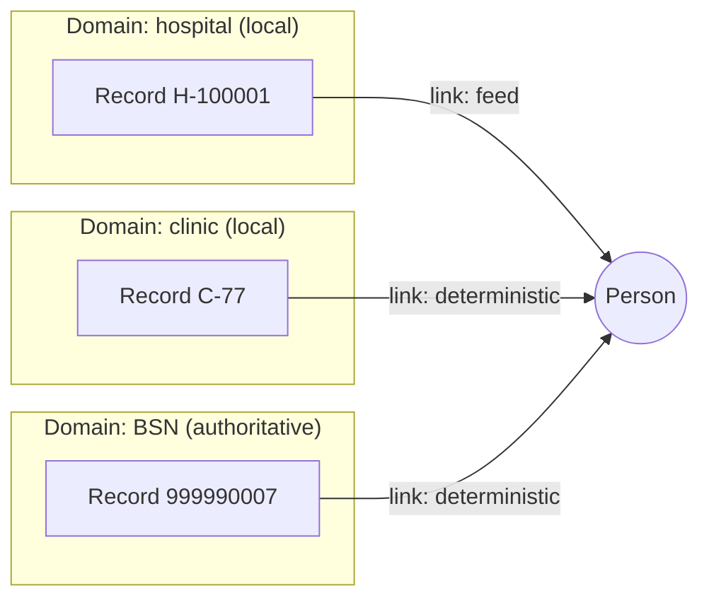
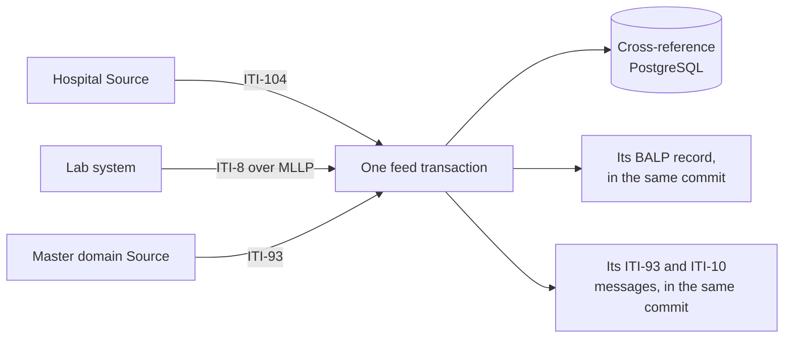
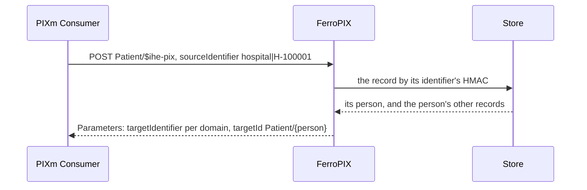
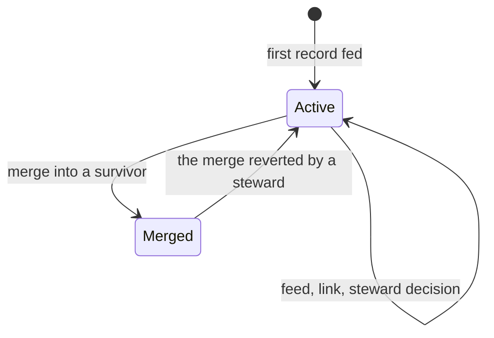
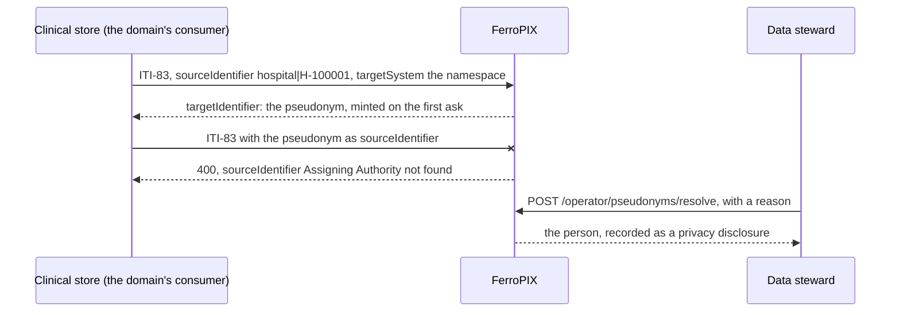

<!-- SPDX-FileCopyrightText: Cadasto B.V. -->
<!-- SPDX-License-Identifier: BUSL-1.1 -->

# How FerroPIX manages patient identity

**Audience:** integrators, operators and decision makers who want the model
behind the transaction pages: what FerroPIX stores about a patient, where
each part comes from, and which rules are the IHE profiles' and which are
FerroPIX's own.

The pages under Integrate say what each transaction reads and answers. This
page explains why they agree with each other: every face reads and writes
one cross-reference, and one person in it is what each of them names.

<!-- toc -->

## The cross-reference

Every organisation numbers its patients in its own way. An **identifier
domain** is one such numbering: the `system` of a FHIR identifier, the
assigning authority of an HL7 v2 identifier. FerroPIX holds what each domain
said about each patient and which of those statements describe one person.
Four things make up that record:

- **An identifier domain**, with a kind. `local` is a system's own numbers,
  such as a hospital's patient number. `authoritative` is a number issued
  to one person only, such as the BSN, so two records that carry it are
  that person. `master` is FerroPIX's own, the Master Patient
  Identification Domain of PMIR, whose system is the server's
  `public_base_url`.
- **A source record**: one domain's identifier for one patient, with the
  demographics its Source sent. A feed writes a new version of the record
  and never overwrites the last one.
- **A person**: the records FerroPIX holds to be one patient. It is the
  Patient Master Identity of PMIR (PMIR 1.6.0 §1:49.1.1.1) and the
  `Patient` every FHIR transaction answers with.
- **A link**: one record joined to one person for a period, with the
  reason it was made (a feed, an authoritative identifier, the scorer, a
  steward, the Source, a merge). A link is closed when it ends, never
  deleted, so the store holds every past state of the cross-reference.

How the store keeps these is no specification's: PIXm fixes what the
Manager answers and what a feed does, and leaves how it holds the
cross-reference to the Manager (PIXm 3.1.0 §2:3.104.4.1.3). The model
above, with its write-once versions and closed links, is FerroPIX's own
design.

## Where identities come from

Each domain has exactly one Patient Identity Source, the one client allowed
to add, revise, merge and remove the domain's identifiers: PIXm requires
that a Manager "shall only recognize a single Patient Identity Source per
domain" (PIXm 3.1.0 §2:3.104.4.1.3). FerroPIX names that client in the
domain's `source_client_id`, and refuses a feed from any other with `403`
(§2:3.104.5). A Source reaches FerroPIX on one of three channels, and all
three land in the same transaction:

| Channel | Transaction | Who sends it |
|---|---|---|
| FHIR | ITI-104 Patient Identity Feed FHIR (PIXm 3.1.0 §2:3.104) | the Source of a `local` or `authoritative` domain, with a client credentials token |
| HL7 v2 | ITI-8 Patient Identity Feed (ITI TF-2 §3.8) | the sender `[[hl7v2.senders]]` names for the domain |
| PMIR | ITI-93 Mobile Patient Identity Feed (PMIR 1.6.0 §2:3.93) | the Source of the `master` domain |

An identifier a fed `Patient` carries in another domain FerroPIX knows, such
as the BSN on a hospital's record, is kept beside the record as a carried
identifier: it can link the record and be asked about, but only its own
domain's Source can feed it as a record. A system that only asks holds no
Source role at all.

## How records become one person

When a feed commits, FerroPIX decides whether the record is a patient it
already holds, in three tiers ([Matching](../operate/matching.md)):

1. **An authoritative identifier links.** Two records whose current
   versions carry the same identifier in an `authoritative` domain are one
   person, unless their birth year or stated gender disagree. A `local`
   value never links across domains: two hospitals that both number a
   patient `12345` say nothing.
2. **The scorer grades the rest.** The demographics of the new version are
   scored against the records that share a blocking key with it, and each
   pair is graded `certain`, `probable`, `possible` or `certainly-not`.
3. **A data steward decides.** A graded pair waits in the review queue,
   and only a steward links it, unless `[matching] auto_link` lets a
   `certain` pair link on its own.

No IHE profile governs this: PIXm places the cross-referencing outside its
scope (§2:3.104.4.1.3), and PDQm asks only that a match carry a score and a
grade (PDQm 3.2.0 §2:3.119.4.2.2.4). The three tiers are FerroPIX's own
design.

## What each face answers

Every face reads the same persons, so a v2 feed and a FHIR query of the same
patient agree:

- **PIXm ITI-83** answers the identifiers of the person a source identifier
  belongs to, in the domains asked for, and the person as `targetId`
  (PIXm 3.1.0 §2:3.83.4.2.2.1). HL7 v2 ITI-9 answers the same set
  ([The PIXm Manager](../integrate/pixm-manager.md)).
- **PDQm ITI-78 and ITI-119** search and score the persons by their
  demographics, and HL7 v2 ITI-21 searches them with the same parameters
  ([The PDQm Supplier](../integrate/pdqm-supplier.md)).
- **XCPD ITI-55** answers another community with the person's identifiers
  in the domains `[xcpd] domains` names
  ([The XCPD Responding Gateway](../integrate/xcpd-gateway.md)).

The `Patient` all of them name is the person: its `id` is the person's id,
its first identifier is that id in the master domain, its other identifiers
are its records', and its demographics are one record's current version, an
`authoritative` domain's first. PIXm says a Manager is "not required to
maintain a Patient resource" (§2:3.104.4.1.3), so serving the person as the
`Patient` is FerroPIX's own design. It is what makes ITI-83's `targetId`,
the entries of ITI-78 and ITI-119, and PMIR's Patient Master Identity the
same resource.

## Merge and unmerge

A merge joins two persons when they turn out to be one patient. The merged
person keeps its id, reads `active = false` with a `replaced-by` link to the
survivor, and its records move to the survivor (FHIR R4 Patient, "Patient
records that have been merged"). A merge has four origins:

| Who | How | Specification |
|---|---|---|
| A Source | an ITI-104 update whose `Patient` has a `replaced-by` link, an HL7 v2 ADT^A40, or an ITI-93 merge from the master domain's Source | PIXm 3.1.0 §2:3.104.4.2, ITI TF-2 §3.8, PMIR 1.6.0 §2:3.93.4.1.2.4 |
| An authoritative identifier | a feed whose record carries an authoritative identifier a record of another person carries | FerroPIX's own design |
| The scorer | a `certain` pair, with `auto_link = true` | FerroPIX's own design |
| A data steward | a link decision in the review queue, or Merge on a patient's page | FerroPIX's own design |

Every merge records what it moved, so it can be reverted. A steward reverts
a merge through the operator API or the console, never a Source: an ITI-93
update that would reactivate a merged person is refused with `405`. Only the
latest merge into a survivor can be reverted, so merges unwind in the order
they were made; PMIR leaves unmerge to the Registry's local policy (PMIR
1.6.0 §2:3.93.4.1.3), and this order is FerroPIX's.

What a merged or removed identifier answers is one policy for every face.
The profiles leave the answer for a deprecated patient to the Manager and
list the forms it may take (PIXm 3.1.0 §2:3.83.4.2.2.5, PDQm 3.2.0
§2:3.78.4.1.3, PMIR 1.6.0 §2:3.93.4.1.3.1). FerroPIX's choice:

- a merged identifier answers the survivor's identifiers in ITI-83 and
  ITI-9;
- a merged person reads `active = false` with its `replaced-by` link in a
  search and a read, or is left out under `[pdqm] deprecated = "omit"`;
- a removed identifier is not found anywhere, as PIXm requires
  (§2:3.104.4.3.3).

## PMIR: the registry and its subscribers

With `[pmir] enabled`, FerroPIX is the Patient Identity Registry of PMIR. It
takes ITI-93 from the master domain's Source and applies each change of the
message in order. It also tells subscribers: every committed change to a
person, from any channel or any steward, is an ITI-93 message to each active
ITI-94 subscription whose criteria match (PMIR 1.6.0 §2:3.93, §2:3.94). The
message is written to the outbox in the transaction that made the change,
so a committed change is never left unannounced, and the sender delivers
each subscription's messages one at a time, in order
([The PMIR Registry](../integrate/pmir-registry.md)). The HL7 v2 face does
the same for its consumers with ITI-10 (ITI TF-2 §3.10). The outbox and its
ordering are FerroPIX's own design.

## Pseudonyms and the forward-only translation

A clinical store such as FerroEHR names a patient by a pseudonym: a UUID per
person and pseudonymisation domain, which identifies no one on its own.
FerroPIX mints and keeps it, so the clinical record holds no identifier that
leads back to a person.

A pseudonymisation domain is a namespace the clinical store names as a
`targetSystem` in ITI-83. PIXm leaves the choice of the identifiers it
answers to the Manager (PIXm 3.1.0 §2:3.83.4.1.2.2, §2:3.83.4.1.3), and
FerroPIX uses that room for three rules of its own design:

- only the domain's one consumer (`consumer_client_id`) reads its
  pseudonyms, and its first ask mints one;
- no other client reads them or causes a mint, so two clinical domains
  cannot be linked through FerroPIX;
- a pseudonym never translates back through PIXm: a `sourceIdentifier` in a
  pseudonymisation domain answers `400`.

The ground is the GDPR. Pseudonymised data "can no longer be attributed to
a specific data subject without the use of additional information, provided
that such additional information is kept separately" (Regulation (EU)
2016/679, Art. 4(5)). FerroPIX is where that information is kept: the clinical store
translates forward only, and the one way back is a steward's resolution
with a reason and a BALP Privacy Disclosure record, a measure of data
protection by design (Art. 25(1)). A pseudonym never changes: after a merge
both persons' pseudonyms resolve to the survivor, and after the revert each
resolves to its own person again ([Pseudonyms](../integrate/pseudonyms.md)).

The Dutch pseudonymised BSN is a different thing: an identifier another
party issues, fed into an `authoritative` domain of its own like any other
identifier ([The Dutch identifiers](../integrate/dutch-identifiers.md)).

## Where the specifications stop

| Question | Answered by |
|---|---|
| What ITI-83 answers, and its three failures | PIXm 3.1.0 §2:3.83.4.2.2 |
| One Source per domain, and what a feed does | PIXm 3.1.0 §2:3.104.4.1.3, §2:3.104.4.2.3, §2:3.104.4.3.3 |
| What a PDQm search and match answer | PDQm 3.2.0 §2:3.78.4.1.3, §2:3.119.4.2.2 |
| The Registry's feed and subscriptions | PMIR 1.6.0 §2:3.93, §2:3.94 |
| The HL7 v2 feed, queries and notification | ITI TF-2 §3.8, §3.9, §3.10, §3.21 |
| How the cross-reference is stored and sealed | FerroPIX's own design |
| When two records are one person | FerroPIX's own design ([Matching](../operate/matching.md)) |
| The `Patient` resource being the person | FerroPIX's own design |
| What a merged identifier answers, and the unmerge order | FerroPIX's own design, within the forms the profiles list |
| Pseudonyms, their one reader and the forward-only translation | FerroPIX's own design, on GDPR Art. 4(5) and Art. 25 |
