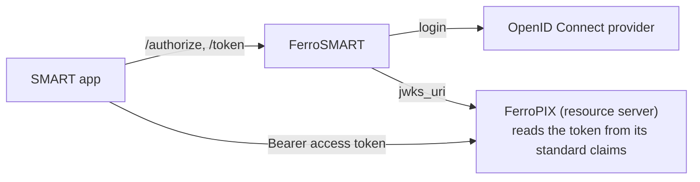

<!-- SPDX-FileCopyrightText: Cadasto B.V. -->
<!-- SPDX-License-Identifier: BUSL-1.1 -->

# Behind FerroSMART

FerroSMART is the FerroHEALTH family's SMART App Launch 2.x authorization
server. It signs people in at any OpenID Connect provider and uses that
provider for login alone. It issues plain RFC 9068 access tokens carrying
the launch context. FerroPIX runs behind it as a resource server: the
person never signs in to FerroPIX, and FerroPIX never sees the provider's
tokens. FerroSMART's architecture describes the whole deployment in
[§13.21, A product behind FerroSMART](https://github.com/FerroHEALTH/FerroSMART/blob/main/docs/architecture.md#1321-a-product-behind-ferrosmart).
This page is FerroPIX's side of it.



## FerroSMART names FerroPIX's base

FerroSMART issues a token only for a base it serves. Its
`[[ferrosmart.resource]]` table names FerroPIX's FHIR base as a `fhir`
resource, so an app can ask for it as the token's audience:

```toml,ferrosmart
[[ferrosmart.resource]]
base = "https://pix.example.org/fhir"
kind = "fhir"
```

## FerroPIX trusts FerroSMART

One `[auth.issuer.<name>]` table naming FerroSMART's issuer trusts it. Its
tokens are read from their standard claims: `typ` is `at+jwt` (RFC 9068
§2.1), and every token carries `scope` (SMART App Launch 2.2.0, Obtain
access token, Response). A token without `scope` is refused with `401`. The
audience is FerroPIX's FHIR base, `{public_base_url}/fhir`, unless the table
names one.

```toml
[auth.issuer.ferrosmart]
issuer = "https://smart.example.org"
```

- **A person through a SMART app.** FerroSMART's client registry is the one
  list of apps. A person's token through any app FerroSMART issued it for
  FerroPIX's audience reads as that person, named by their `fhirUser`. A
  token for another audience is refused with `401`.
- **A Backend Services client.** A client credentials token's `sub` is its
  `client_id` (RFC 9068 §2.2), so the same table reads it as the system. A
  Source still needs its `[[trust.issuer]]` client, naming the table
  (`issuer = "ferrosmart"`), and its domain, as with any issuer
  ([Configuration](configuration.md)).
- **One table per issuer.** Name FerroSMART in this one table. A second
  `[auth.issuer.<name>]` table of the same issuer refuses the start, naming
  the issuer (FerroHEALTH/FerroSMART#591).

The scopes a token grants still meet FerroPIX's permission table: the
`system/` scopes and the steward and administrator scopes
([Security](security-and-audit.md)).

## The discovery document describes FerroSMART

`GET https://pix.example.org/fhir/.well-known/smart-configuration` describes
the issuer `ferrohealth-smart`'s shared rule picks. With FerroSMART as the
one SMART issuer, that is FerroSMART: the document names its
`authorization_endpoint` and `token_endpoint`, so an app that starts at
FerroPIX's base finds FerroSMART (SMART App Launch 2.2.0, Conformance,
Metadata). When FerroPIX trusts another SMART issuer beside it, `[auth] described_issuer = "ferrosmart"` names FerroSMART's table. The capability statement's
`rest.security` names the same token endpoint.

No specification governs this deployment shape: our own design, built on
SMART App Launch 2.2.0 and RFC 9068.
